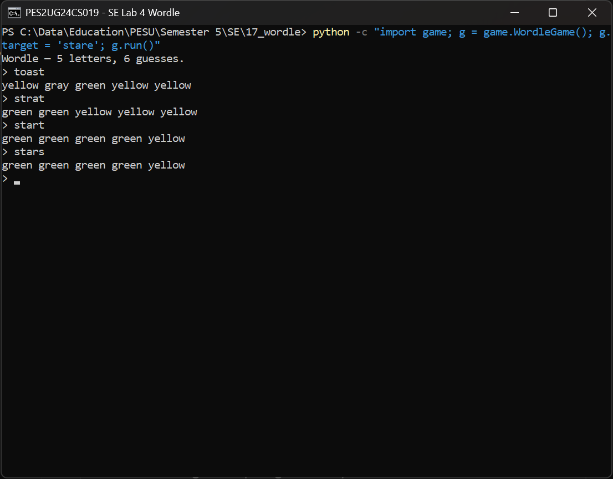
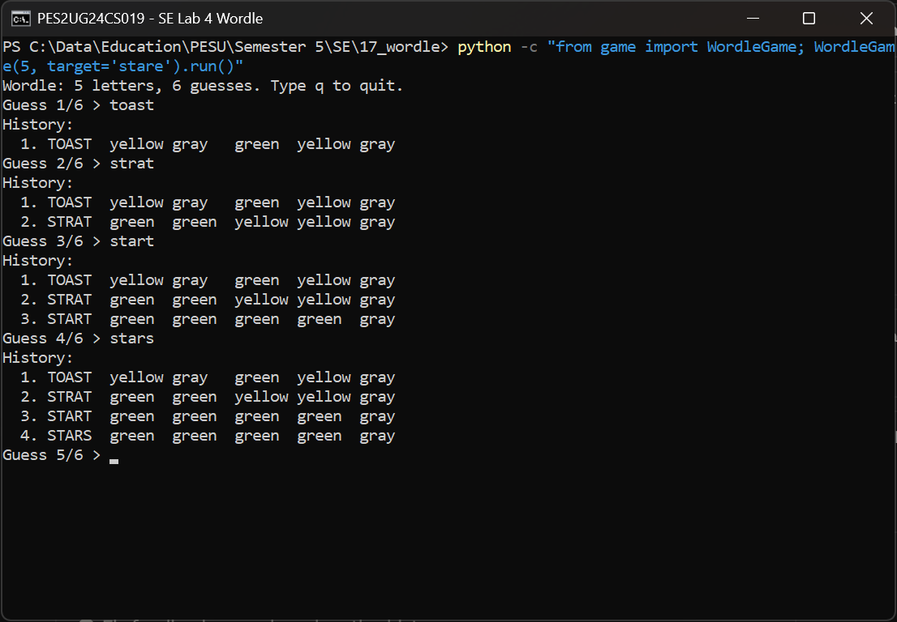
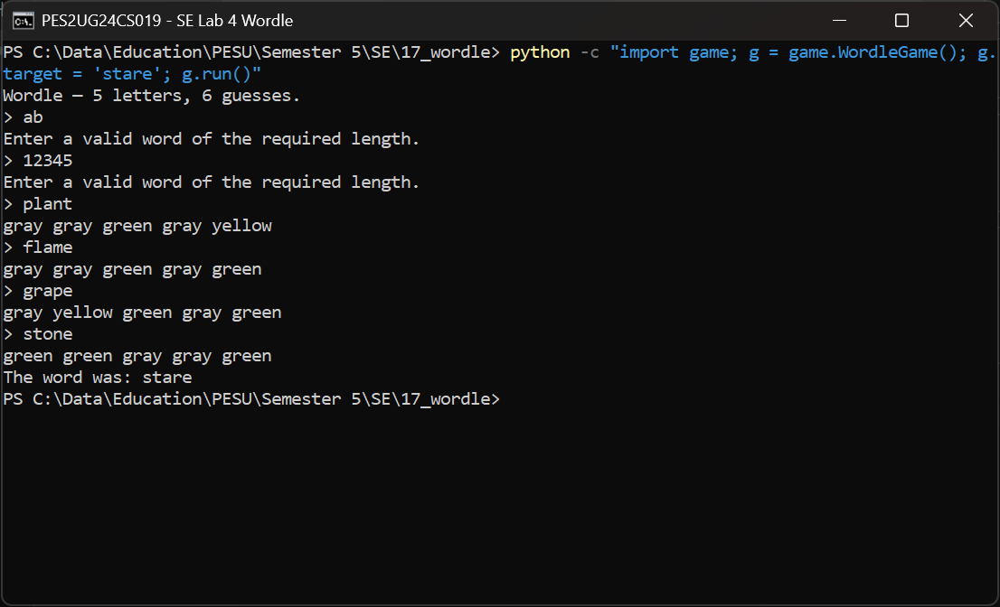
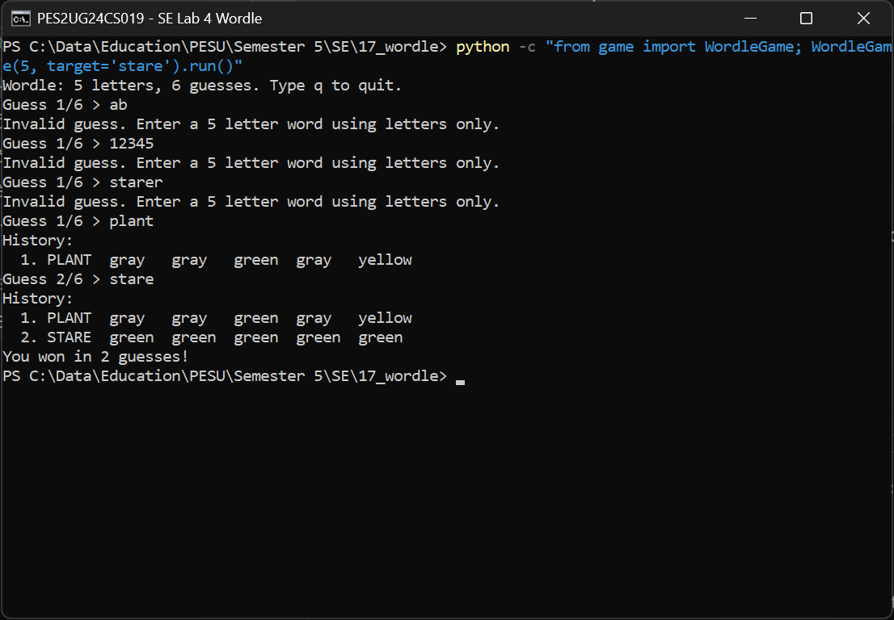
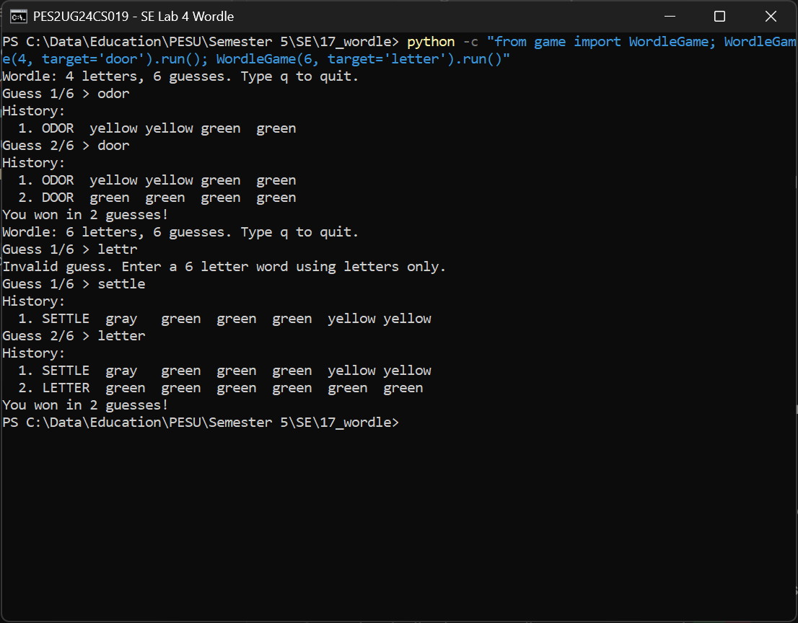
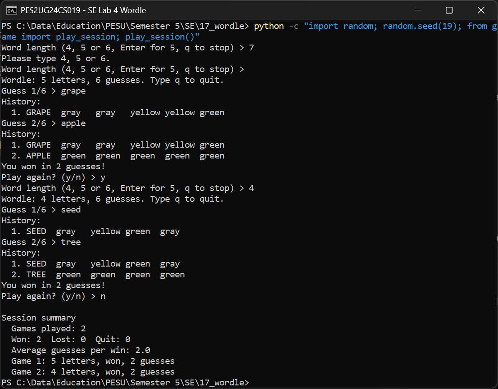
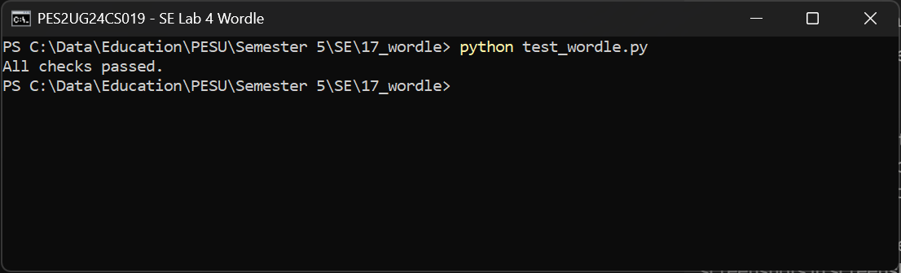
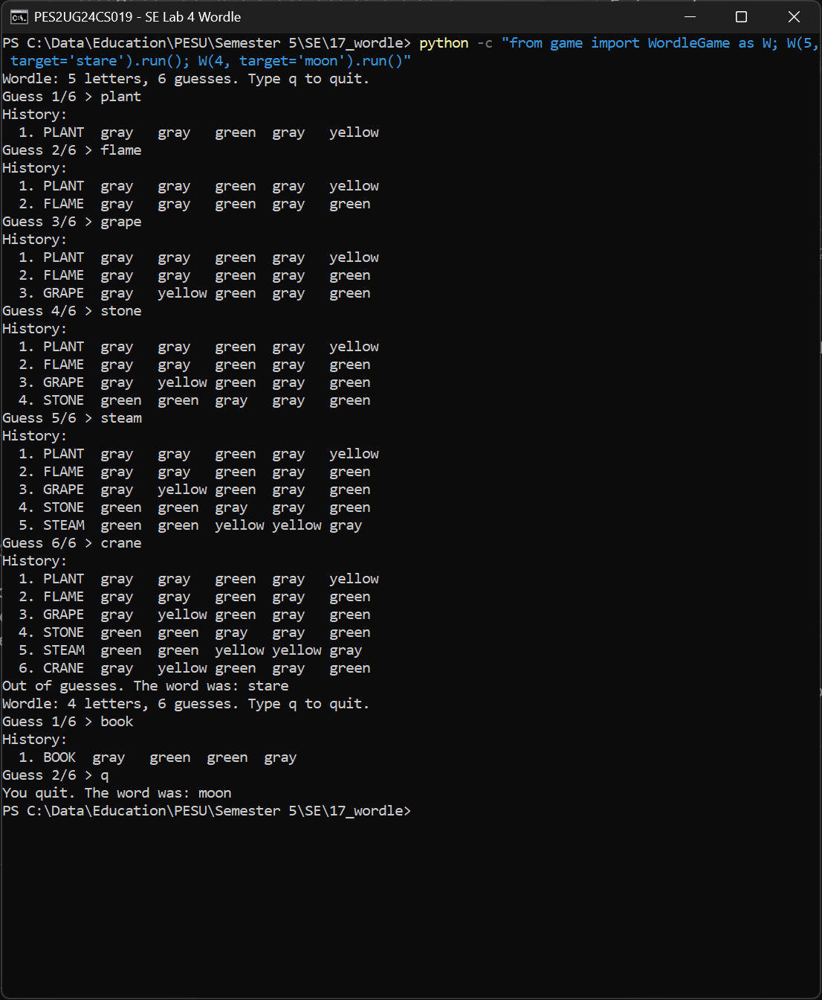

# Lab 4: Vibe Coding

Individual lab. I was given a broken terminal Wordle game and had to fix it and add features
using an AI coding assistant, then test the result myself.

- Assigned repo: [SETAPESU26/17_wordle](https://github.com/SETAPESU26/17_wordle) (scenario 17)
- Tool used: Claude (Claude Code in the Claude desktop app)
- Chat history: [docs/PES2UG24CS019_SE_Lab4_chat.pdf](docs/PES2UG24CS019_SE_Lab4_chat.pdf) (docx in the same folder)

No PR was raised to the SETAPESU26 repo. The updated code lives only here.

## What was broken

1. **Duplicate letters.** `evaluate()` marked a letter yellow whenever it appeared anywhere in the
   target, without counting copies. With the target `stare`, guessing `start` gave the last `t`
   yellow even though the only `t` was already used by a green.
2. **Invalid guesses used up turns.** The game looped `for _ in range(6)`, so typing `ab` or
   `12345` still cost one of the six guesses.

## What I changed

| Task | Change | File |
| ---- | ------ | ---- |
| 1. Duplicate letter feedback | Greens are marked first. Then each leftover target letter can give at most one yellow, tracked with a `Counter`. | `feedback.py` |
| 2. Guess handling | The loop now counts accepted guesses only, so invalid input does not use a turn. Clear win, loss and quit messages. Guess number shown as `Guess 3/6`. | `game.py` |
| 3. Word lengths | 4, 5 and 6 letter modes. Added 4 and 6 letter words to the in-memory list. Feedback logic already works for any length. | `words.py`, `game.py` |
| 4. History and summary | Full history printed after each accepted guess, invalid attempts are never added. Session summary at the end with games played, won, lost, quit and average guesses per win. | `game.py`, `main.py` |

Everything stays in memory and only the standard library is used, as the scenario README asks.

## Testing

`code/test_wordle.py` covers the README's required testing list: repeated letters (both ways round),
exact matches, absent letters, invalid lengths, all three word lengths, winning on the sixth guess,
losing, quitting, and the session summary.

```
cd code
python test_wordle.py
python main.py
```

## Screenshots

The handout asked for before and after videos. Ma'am said screenshots are fine instead.

| Before | After |
| ------ | ----- |
|  Target `stare`. Extra `t` and `s` show yellow. |  Same guesses, extra copies now gray. |
|  Two invalid inputs ate turns, game ended after 4 real guesses. |  Invalid inputs stay on `Guess 1/6`. |



4 and 6 letter games, both with repeated letters.



Length prompt, history after each guess, and the session summary. The run is seeded so it can be
repeated.



All checks in `test_wordle.py` passing.



Losing after six accepted guesses, then quitting a 4 letter game.

## Layout

```
lab4-vibecoding/
  code/         updated game and test file
  screenshots/  before and after evidence
  docs/         chat history pdf
```
