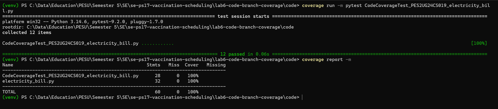
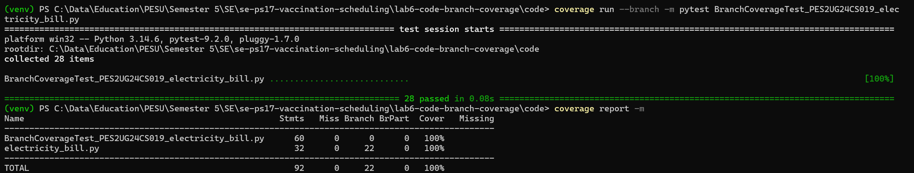

# Lab 6: Code and Branch Coverage

Individual lab, not tied to the vaccination system. I was given a small Python module with two
starter tests and had to write more tests until both line coverage and branch coverage were above
90%, measured with `coverage` and `pytest`.

- Assigned repo: [SETAPESU26/L6_L7_17_electricity_bill](https://github.com/SETAPESU26/L6_L7_17_electricity_bill)
  (the `Lab 6` folder)
- Module: `electricity_bill.py`. It works out an electricity bill from unit slabs, adds a late
  payment fee and calculates subsidies.
- Deliverable document: [docs/PES2UG24CS019_SE_Lab6.docx](docs/PES2UG24CS019_SE_Lab6.docx)

## Results

Coverage numbers are for `electricity_bill.py`.

| Test file | Tests | Line coverage | Branch coverage |
|-----------|-------|---------------|-----------------|
| `test_electricity_bill.py` (starter) | 2 | 38% | 31% |
| `CodeCoverageTest_PES2UG24CS019_electricity_bill.py` | 12 | 100% | 98%, one branch missed |
| `BranchCoverageTest_PES2UG24CS019_electricity_bill.py` | 28 | 100% | 100%, 22 of 22 branches |

The code coverage file runs every line but still misses one decision. In `late_fee`, when a bill
is paid more than 15 days late, the inner `if bill_amount > 2000` was only ever true. A late bill of
2000 or less never ran, and line coverage could not see that, because there is no `else` line to
miss. This is the gap the handout talks about: 100% line coverage, not 100% branch coverage.

The branch coverage file keeps all 12 tests and adds 16. One covers the missed branch (`late_fee(500, 16)`).
The rest test the values where each decision flips: 100 and 101 units, 300 and 301 units, 15 and 16
days late, a bill of exactly 2000 and 2001, and the same edges for the subsidy rules. These were
not needed for the percentage, but they are where a wrong `<` or `<=` would show up.

## Commits

1. Original module and starter test, the code coverage test file, and `01-code-coverage.png`
2. The branch coverage test file and `02-branch-coverage.png`
3. This README, the document and the root README update

## Screenshots



Code coverage: 12 tests pass, `electricity_bill.py` at 100% line coverage.



Branch coverage: 28 tests pass, `electricity_bill.py` at 100% with all 22 branches taken.

## Running it

```
cd code
coverage run -m pytest CodeCoverageTest_PES2UG24CS019_electricity_bill.py
coverage report -m
coverage run --branch -m pytest BranchCoverageTest_PES2UG24CS019_electricity_bill.py
coverage report -m
```

## Layout

```
lab6-code-branch-coverage/
  code/         module, starter test and the two coverage test files
  screenshots/  terminal output after reaching the coverage targets
  docs/         deliverable docx and pdf
```
