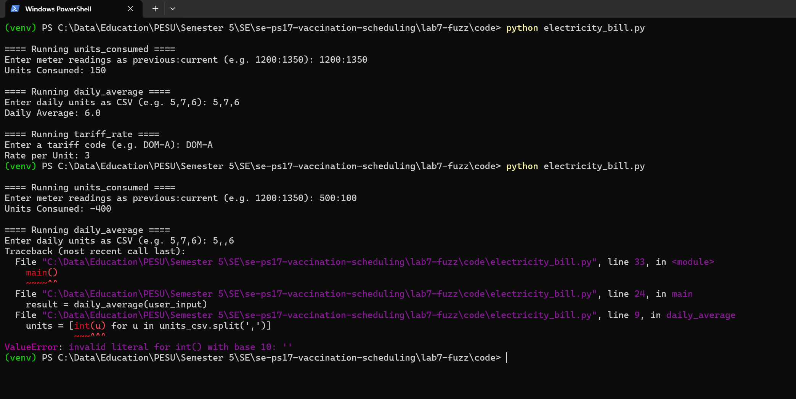
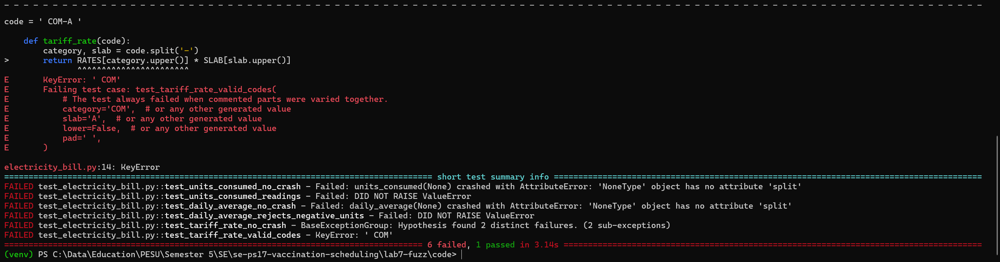
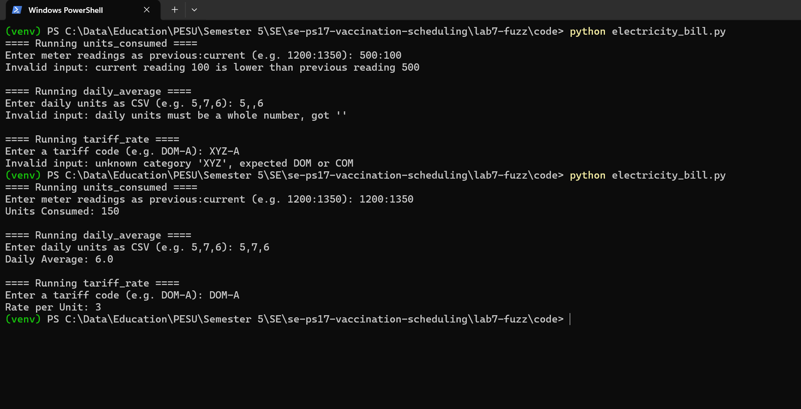
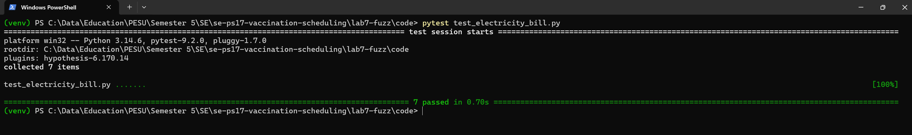

# Lab 7: Fuzz Testing with Hypothesis

Individual lab, not tied to the vaccination system. I was given a small Python module that parses
user input for an electricity bill, and had to use Hypothesis to find the inputs that break it,
then fix it.

- Assigned repo: [SETAPESU26/L6_L7_17_electricity_bill](https://github.com/SETAPESU26/L6_L7_17_electricity_bill)
  (the `Lab 7` folder, same repo as Lab 6)
- Module: `electricity_bill.py`, with three functions that read text typed by the user
  - `units_consumed("1200:1350")` gives the units used between two meter readings
  - `daily_average("5,7,6")` gives the average of daily units
  - `tariff_rate("DOM-A")` gives the rate per unit for a category and slab
- Deliverable document: [docs/PES2UG24CS019_SE_Lab7.docx](docs/PES2UG24CS019_SE_Lab7.docx)

## The approach

A bad input should be rejected, not crash the program. I decided every function would either
return a correct answer or raise `ValueError` with a message saying what was wrong. No other
exception type is allowed out, and `main()` catches `ValueError` and prints `Invalid input: ...`.

The tests in `code/test_electricity_bill.py` follow that rule:

| Test | What Hypothesis feeds it | Fails when |
|------|--------------------------|------------|
| `test_units_consumed_no_crash` | random text, `None`, half valid readings like `-5::12` | anything other than `ValueError` is raised, or units come back negative |
| `test_units_consumed_readings` | two random readings | the units are wrong, or a reading going backwards is accepted |
| `test_daily_average_no_crash` | random text, `None`, messy CSV like `5,,abc` | anything other than `ValueError`, or a negative average |
| `test_daily_average_matches_mean` | lists of valid daily units | the average does not match the real mean |
| `test_daily_average_rejects_negative_units` | valid units plus one negative value | the negative value is accepted |
| `test_tariff_rate_no_crash` | random text, `None`, messy codes like `DOM--b` | anything other than `ValueError`, or a rate that does not exist |
| `test_tariff_rate_valid_codes` | every valid code, in random case, with spaces around it | the rate is wrong or the code is refused |

## What the fuzzer found

Against the original code, 6 of the 7 tests failed. Hypothesis shrank each failure to a small input:

| Input | Original behaviour | After the fix |
|-------|--------------------|---------------|
| `None` (any function) | `AttributeError`, `None` has no `split` | `ValueError`: must be text |
| `"500:100"` | returns -400 units | `ValueError`: current reading is lower than previous |
| `"1200"` | `ValueError` from unpacking, no useful message | `ValueError`: must look like previous:current |
| `"5,,6"` | crashes on `int('')` | `ValueError`: must be a whole number |
| `"-3"` as a daily value | averaged as if it were real | `ValueError`: cannot be negative |
| `"XYZ-A"` | `KeyError: 'XYZ'` | `ValueError`: unknown category |
| `" COM-A "` | `KeyError: ' COM'` | accepted, rate 6 |
| `"DOM-A-B"` | `ValueError` from unpacking | `ValueError`: must look like DOM-A |

The only test that passed on the original code was `test_daily_average_matches_mean`, because
for clean input the arithmetic was already right.

## Screenshots



Original program: normal input works, `500:100` gives -400 units, and `5,,6` crashes.



Fuzz tests against the original code: 6 failed, 1 passed.



Fixed program: the same bad inputs each print a reason, and normal input still gives 150, 6.0 and 3.



Fuzz tests against the fixed code: 7 passed.

## Commits

1. Original module, completed fuzz tests, screenshots 01 and 02
2. Fixed module, screenshots 03 and 04
3. This README, the document and the root README update

## Running it

```
cd code
pip install hypothesis pytest
python electricity_bill.py
pytest test_electricity_bill.py
```

## Layout

```
lab7-fuzz/
  code/         fixed electricity_bill.py and the Hypothesis tests
  screenshots/  program and test output, before and after the fix
  docs/         deliverable docx and pdf
```
